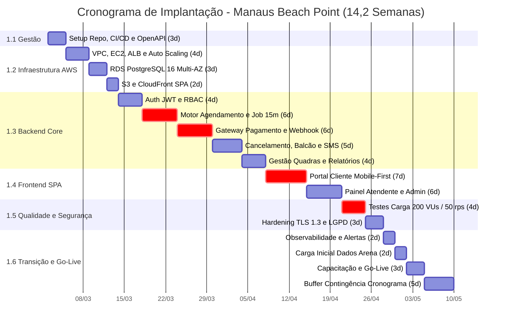

# Plano de Projeto — Manaus Beach Point

**Repositório Base:** Etapa 1 (`Trabalho_Pratico.pdf`)  
**Autor / Equipe:** 1 integrante (Gerência, Arquitetura, Desenvolvimento Full-Stack e DevOps)  
**Horizonte de Planejamento:** Implantação (MVP) + 3 Anos de Operação  

---

## 1. Premissas, Restrições e Estrutura da Equipe

Para garantir a viabilidade técnica e financeira das decisões tomadas na Etapa 1, o planejamento adota as seguintes premissas e restrições:

* **Capacidade da Equipe:** Execução realizada por **1 profissional multidisciplinar** assumindo os papéis de Gerente de Projeto, Arquiteto de Software, Desenvolvedor Full-Stack e Engenheiro DevOps, com dedicação de **4 horas por dia útil (20 horas/semana)**.
* **Escopo Técnico (Etapa 1):** Plataforma web responsiva (SPA React + TypeScript) e API RESTful (Node.js + TypeScript + Express) com banco relacional PostgreSQL 16, cobrindo os requisitos `RF01–RF10`, `RNF01–RNF06` e regras de negócio `RN01–RN05`.
* **Premissa de Escala em 3 Anos (OPEX):**
  * **Ano 1:** Operação piloto em **1 arena** em Manaus (horário nobre de 17h às 22h, picos de até 200 usuários simultâneos).
  * **Ano 2:** Expansão comercial para **2 arenas** (ativação horizontal via Auto Scaling Group no EC2).
  * **Ano 3:** Expansão comercial para **3 arenas** (aumento de throughput de escritas e armazenamento no RDS Multi-AZ).
* **Restrição Orçamentária:** Modelo enxuto em nuvem (AWS região `sa-east-1` — São Paulo), evitando compra de servidores físicos locais e utilizando serviços gerenciados sob demanda (`ADR-003`).

---

## 2. Estrutura Analítica do Projeto (EAP / WBS)

A EAP decompõe 100% do escopo técnico definido na Etapa 1, incluindo explicitamente os **pacotes de transição operacional** exigidos para o *Go-Live* seguro (Observabilidade, Migração/Carga Inicial e Capacitação).

```mermaid
flowchart TD
    P[1.0 Manaus Beach Point - MVP] --> G[1.1 Gestão e Arquitetura]
    P --> I[1.2 Infraestrutura Cloud AWS]
    P --> B[1.3 Backend API e Regras de Negócio]
    P --> F[1.4 Frontend SPA Responsivo]
    P --> Q[1.5 Qualidade, Carga e Segurança]
    P --> T[1.6 Transição e Operação]

    G --> G1[1.1.1 Setup Repositório, CI/CD e Contratos OpenAPI]

    I --> I1[1.2.1 Provisionamento VPC, EC2, ALB e Auto Scaling]
    I --> I2[1.2.2 Deploy RDS PostgreSQL 16 Multi-AZ e Schema]
    I --> I3[1.2.3 Configuração S3 e CloudFront para SPA]

    B --> B1[1.3.1 Autenticação Stateless JWT e RBAC]
    B --> B2[1.3.2 Motor de Agendamento, Trava UNIQUE e Job 15min]
    B --> B3[1.3.3 Integração Gateway Pagamento Cartão/Pix e Webhooks]
    B --> B4[1.3.4 Cancelamento 12h, Check-in Balcão e Notificações]
    B --> B5[1.3.5 Gestão de Quadras, Preços e Relatórios Admin]

    F --> F1[1.4.1 Portal Cliente - Consulta, Reserva e Checkout]
    F --> F2[1.4.2 Painel Operacional Atendente e Admin]

    Q --> Q1[1.5.1 Testes de Carga 200 VUs e 50 Escritas/s]
    Q --> Q2[1.5.2 Hardening TLS 1.3, LGPD e Auditoria]

    T --> T1[1.6.1 Observabilidade - CloudWatch, Logs e Alarmes]
    T --> T2[1.6.2 Carga Inicial de Quadras, Horários e Usuários]
    T --> T3[1.6.3 Capacitação Operadores e Playbooks Contingência]
```

### Dicionário da EAP e Rastreabilidade com a Etapa 1

| ID | Pacote de Trabalho | Entregável Principal | Rastreabilidade (Etapa 1) |
| :--- | :--- | :--- | :--- |
| **1.1.1** | Setup Repositório, CI/CD e OpenAPI | Pipeline GitHub Actions e especificação das rotas REST | C4 Nível 2 e Nível 3 |
| **1.2.1** | Provisionamento VPC, EC2, ALB e ASG | Ambiente isolado AWS `sa-east-1` com balanceamento e escala | `ADR-003`, `RNF01`, `RNF03` |
| **1.2.2** | Deploy RDS PostgreSQL 16 Multi-AZ | Banco relacional com `UNIQUE (quadra_id, data_hora_inicio)` | `ADR-001`, `ADR-003`, `RN02` |
| **1.2.3** | Configuração S3 e CloudFront | Bucket privado + CDN HTTPS para hospedagem do frontend | `ADR-003`, `RNF04` |
| **1.3.1** | Autenticação Stateless JWT e RBAC | Cadastro, login, refresh token e controle de perfis | `RF01`, `RF07`, `RNF02`, `ADR-002` |
| **1.3.2** | Motor Agendamento e Job Expiração | `POST /reservas` idempotente, limite 3 reservas e cron 15 min | `RF02`, `RF03`, `RN01`, `RN02`, `RN04`, `RN05` |
| **1.3.3** | Gateway Pagamento Cartão/Pix | Geração checkout, webhook assinado e confirmação automática | `RF04`, C4 Nível 2 (Gateway) |
| **1.3.4** | Cancelamento, Balcão e Notificações | Estorno 12h/50%, check-in presencial e envio E-mail/SMS | `RF05`, `RF06`, `RN03` |
| **1.3.5** | Gestão Quadras, Preços e Relatórios | CRUD quadras/tarifas, bloqueio manutenção e faturamento | `RF08`, `RF09`, `RF10` |
| **1.4.1** | Portal Cliente (SPA React) | Fluxo mobile-first de reserva em até 5 cliques / 2 minutos | `RF01–RF05`, `RNF04` |
| **1.4.2** | Painel Operacional Atendente/Admin | Telas de check-in diário, cadastro quadras e relatórios | `RF06–RF10`, `RNF04` |
| **1.5.1** | Testes de Carga e Concorrência (k6) | Relatório validando `p95 <= 500 ms` e `50 escritas/s` | `RNF01`, `RNF05`, `RNF06` |
| **1.5.2** | Hardening TLS 1.3, LGPD e Auditoria | Certificados SSL, hash bcrypt, mascaramento e logs | `RNF02` |
| **1.6.1** | **Observabilidade (Transição)** | Dashboards CloudWatch (CPU, p95, conexões RDS) e alertas | `RNF03` (Disponibilidade 99,5%) |
| **1.6.2** | **Carga Inicial de Dados (Transição)** | Scripts SQL de cadastro das quadras, grades e tarifas da arena | Transição Operacional |
| **1.6.3** | **Capacitação e Playbooks (Transição)** | Treinamento da equipe da arena e manual de operação/falhas | Transição Operacional |

---

## 3. Estimativas de Duração (PERT) e Cronograma

Para mitigar o risco de subestimativa em um projeto executado por apenas 1 desenvolvedor, aplicou-se a **Estimativa de Três Pontos (PERT)** em **dias úteis (jornada de 4h/dia)**:

$$t_e = \frac{O + 4M + P}{6} \qquad \text{e} \qquad \sigma = \frac{P - O}{6}$$

| ID | Pacote de Trabalho | Otimista ($O$) | Mais Provável ($M$) | Pessimista ($P$) | Estimado ($t_e$) | Desvio ($\sigma$) | Dependência |
| :--- | :--- | :---: | :---: | :---: | :---: | :---: | :--- |
| **1.1.1** | Setup Repo, CI/CD e OpenAPI | 2 | 3 | 4 | **3,0 dias** | 0,33 | — |
| **1.2.1** | Provisionamento VPC, EC2, ALB e ASG | 3 | 4 | 6 | **4,2 dias** | 0,50 | 1.1.1 |
| **1.2.2** | Deploy RDS PostgreSQL 16 Multi-AZ | 2 | 3 | 5 | **3,2 dias** | 0,50 | 1.2.1 |
| **1.2.3** | Configuração S3 e CloudFront | 1 | 2 | 3 | **2,0 dias** | 0,33 | 1.2.1 |
| **1.3.1** | Auth Stateless JWT e RBAC | 3 | 4 | 6 | **4,2 dias** | 0,50 | 1.2.2 |
| **1.3.2** | Motor Agendamento e Job 15 min | 4 | 6 | 10 | **6,3 dias** | 1,00 | 1.3.1 |
| **1.3.3** | Pagamento Cartão/Pix e Webhooks | 4 | 6 | 9 | **6,2 dias** | 0,83 | 1.3.2 |
| **1.3.4** | Cancelamento 12h, Balcão e E-mail/SMS | 3 | 5 | 8 | **5,2 dias** | 0,83 | 1.3.3 |
| **1.3.5** | Gestão Quadras, Preços e Relatórios | 3 | 4 | 6 | **4,2 dias** | 0,50 | 1.3.1 |
| **1.4.1** | Portal Cliente SPA (React/TS) | 5 | 7 | 11 | **7,3 dias** | 1,00 | 1.3.4 |
| **1.4.2** | Painel Atendente e Admin (React/TS) | 4 | 6 | 9 | **6,2 dias** | 0,83 | 1.3.5 |
| **1.5.1** | Testes Carga (200 VUs / 50 req/s) | 2 | 3 | 6 | **3,3 dias** | 0,67 | 1.4.1, 1.4.2 |
| **1.5.2** | Hardening TLS 1.3, LGPD e Auditoria | 2 | 3 | 4 | **3,0 dias** | 0,33 | 1.5.1 |
| **1.6.1** | Observabilidade (CloudWatch/Alertas) | 2 | 2 | 4 | **2,3 dias** | 0,33 | 1.5.2 |
| **1.6.2** | Carga Inicial Quadras e Tarifas | 1 | 2 | 3 | **2,0 dias** | 0,33 | 1.6.1 |
| **1.6.3** | Capacitação Operadores e Go-Live | 2 | 3 | 4 | **3,0 dias** | 0,33 | 1.6.2 |
| **TOTAL** | **Soma Sequencial (1 Recurso Humano)** | **43** | **63** | **98** | **65,6 dias** | **—** | **~13,1 semanas** |

> **Caminho Crítico e Buffer Estatístico:** Como a equipe é composta por **1 pessoa**, todas as atividades são executadas sequencialmente pelo mesmo recurso, tornando a cadeia completa o caminho crítico ($\approx 66\text{ dias úteis}$). O desvio-padrão acumulado da cadeia é $\sigma_{total} = \sqrt{\sum \sigma_i^2} \approx 2,52\text{ dias}$. Aplicando uma margem de segurança de $2\sigma$ (~95% de nível de confiança), adiciona-se um **buffer de cronograma de 5 dias úteis**, totalizando **71 dias úteis (~14,2 semanas)**.

### Cronograma Visual (Mermaid Gantt)

---

## 4. Orçamento de Implantação e Operação (TCO — 3 Anos)

Os valores foram calculados em **Reais (BRL)** considerando taxa de câmbio de referência **US$ 1,00 = R$ 5,60**, tabela de preços da AWS região **`sa-east-1` (São Paulo)** e taxa técnica de **R$ 65,00/hora** para desenvolvimento/arquitetura.

