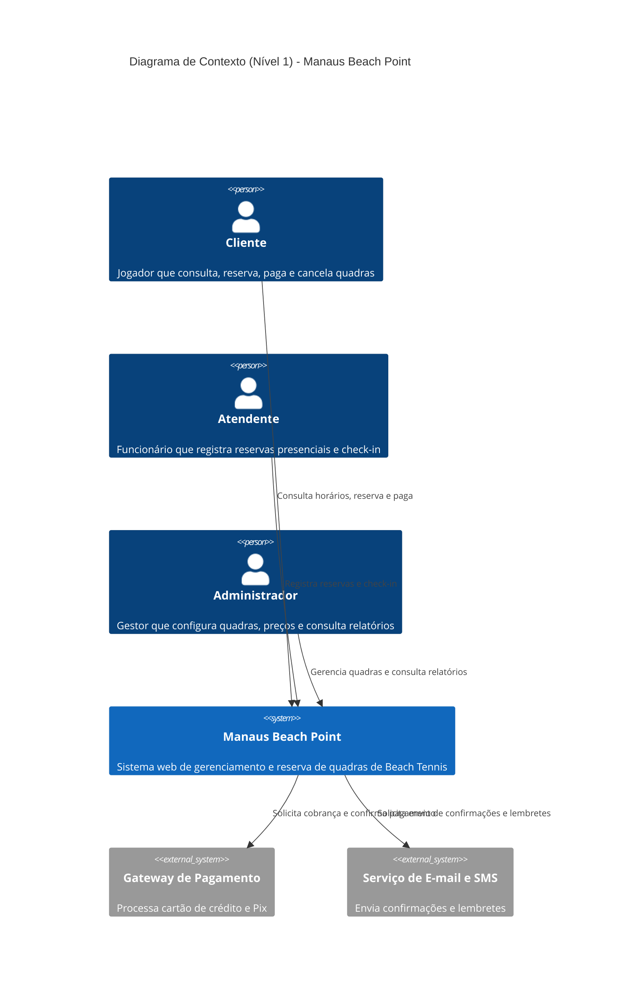
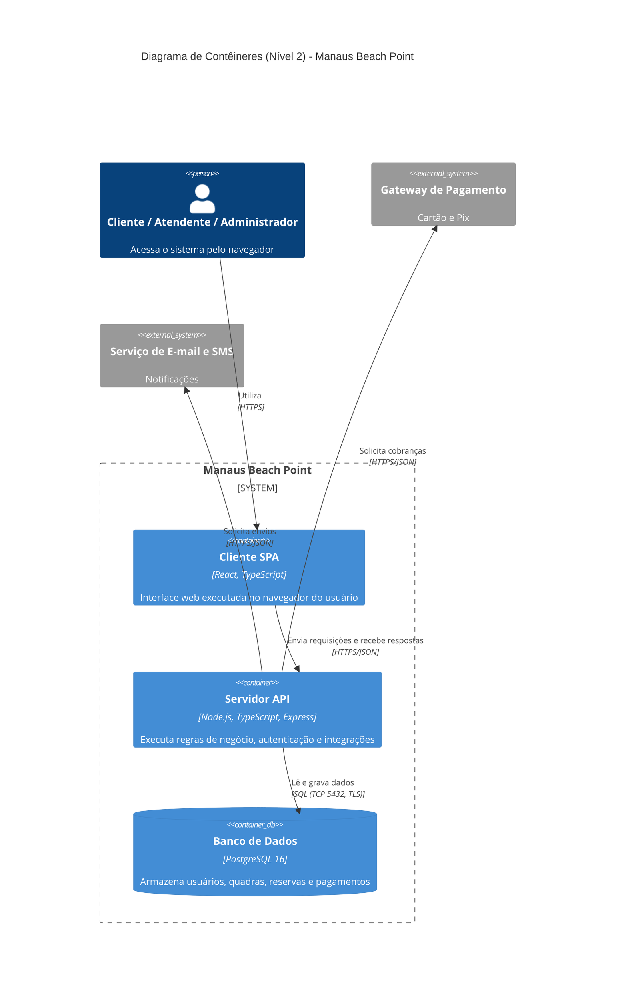

# Trabalho Individual — Requisitos e Arquitetura de um Sistema
**Disciplina:** Projetos de Sistemas  
**Instituição:** Centro Universitário de Ensino Superior do Amazonas — CIESA 
**Aluno:** Diogo Dos Santos De Souza

## 1. Visão Geral

### 1.1 Descrição do Sistema
O Beach Tennis é um dos esportes de areia que mais cresce no Brasil, e em Manaus, onde o clima quente e chuvoso favorece a prática em arenas descobertas e cobertas, a demanda por quadras aumentou consideravelmente. Hoje, grande parte das arenas administra agendamentos por mensagens de aplicativos, planilhas e cadernos, o que gera conflitos de horário (overbooking), dificuldade de confirmar pagamentos, perda de receita com faltas e pouca visibilidade sobre a ocupação das quadras. O **Manaus Beach Point** é um sistema web para gerenciamento e reserva de quadras de Beach Tennis que centraliza consulta de horários, reserva, pagamento, cancelamento e acompanhamento gerencial em uma única plataforma. O sistema atende a três perfis de usuários: o **Cliente**, jogador que consulta a disponibilidade, reserva e paga horários, e cancela reservas pela web; o **Atendente**, funcionário da arena que registra reservas presenciais ou por telefone, confirma a presença dos clientes (check-in) e resolve pendências de pagamento no balcão; e o **Administrador**, responsável pela arena, que cadastra quadras, define horários e preços, gerencia usuários e consulta relatórios de ocupação e faturamento.

### 1.2 Regra Central de Rastreabilidade
Toda decisão de arquitetura documentada neste arquivo é estritamente rastreável a um requisito declarado na Parte 1.

---

## 2. Parte 1 — Requisitos

### 2.1 Tabela de Requisitos

| Código | Tipo | Descrição | Prioridade |
| :--- | :--- | :--- | :--- |
| **RF01** | Funcional | O sistema deve permitir que o Cliente crie uma conta e realize login com e-mail e senha. | Alta |
| **RF02** | Funcional | O sistema deve permitir que o Cliente consulte os horários disponíveis das quadras filtrando por data e por quadra. | Alta |
| **RF03** | Funcional | O sistema deve permitir que o Cliente reserve uma quadra em um horário disponível. | Alta |
| **RF04** | Funcional | O sistema deve permitir que o Cliente pague a reserva online por cartão de crédito ou Pix. | Alta |
| **RF05** | Funcional | O sistema deve permitir que o Cliente cancele uma reserva própria dentro do prazo permitido. | Alta |
| **RF06** | Funcional | O sistema deve permitir que o Cliente visualize o histórico e o status de suas reservas. | Média |
| **RF07** | Funcional | O sistema deve permitir que o Atendente registre uma reserva presencial ou telefônica em nome de um cliente. | Alta |
| **RF08** | Funcional | O sistema deve permitir que o Atendente registre o check-in do cliente na chegada à arena. | Média |
| **RF09** | Funcional | O sistema deve permitir que o Administrador cadastre, edite e desative quadras, horários de funcionamento e preços. | Alta |
| **RF10** | Funcional | O sistema deve permitir que o Administrador gere relatórios de ocupação e faturamento por período. | Média |
| **RNF01** | Não Funcional (Desempenho) | O percentil 95 do tempo de resposta da API para a consulta de horários (GET /horarios) deve ser de no máximo 500 ms com 200 usuários simultâneos. | Alta |
| **RNF02** | Não Funcional (Segurança) | Todo tráfego entre navegador e servidor deve usar TLS 1.3 e as senhas devem ser armazenadas com hash bcrypt com custo mínimo 12; tokens de acesso devem expirar em no máximo 15 minutos. | Alta |
| **RNF03** | Não Funcional (Disponibilidade) | O sistema deve ter disponibilidade mensal mínima de 99,5% (máximo de aproximadamente 3 h 39 min de indisponibilidade por mês), com RPO máximo de 15 minutos e RTO máximo de 1 hora. | Alta |
| **RNF04** | Não Funcional (Usabilidade) | Um cliente novo, sem treinamento, deve concluir uma reserva em no máximo 5 cliques/toques e 2 minutos, com taxa de sucesso mínima de 90% em teste com 10 usuários. | Média |
| **RNF05** | Não Funcional (Compatibilidade) | A interface deve funcionar sem erros nas duas últimas versões estáveis do Chrome, Firefox, Safari e Edge, e em telas de 360 px a 1920 px de largura. | Média |
| **RNF06** | Não Funcional (Escalabilidade) | O servidor deve processar no mínimo 50 requisições de escrita por segundo (POST /reservas) com taxa de erro 5xx inferior a 0,5%, mantendo uso de CPU abaixo de 75%. | Média |
| **RN01** | Regra de Negócio | Cada reserva ocupa exatamente 1 hora de quadra, com início em hora cheia, entre 06h e 22h, todos os dias. | Alta |
| **RN02** | Regra de Negócio | Uma quadra não pode ter duas reservas ativas no mesmo horário. | Alta |
| **RN03** | Regra de Negócio | O cancelamento com reembolso integral só é permitido até 12 horas antes do horário reservado; após esse prazo, retém-se 50% do valor. | Alta |
| **RN04** | Regra de Negócio | A reserva só é confirmada após o pagamento; reservas não pagas em até 15 minutos são liberadas automaticamente. | Alta |
| **RN05** | Regra de Negócio | Um cliente pode manter no máximo 3 reservas futuras ativas simultaneamente. | Média |

---

## 3. Parte 2 — Documento de Arquitetura

### 3.1 Diagramas C4 (Níveis 1 a 3)

#### Nível 1: Contexto
> **Legenda:** Pessoas representam os perfis de usuário; o retângulo azul é o sistema central em desenvolvimento; retângulos cinza representam os sistemas de parceiros externos integrados. As setas indicam o sentido do fluxo de informação e descrevem as interações operacionais.



#### Nível 2: Contêineres
> **Legenda:** Cada caixa interna azul representa um contêiner de software implantável e independente que compõe o ecossistema da aplicação, explicitando suas tecnologias. As setas especificam rigidamente os protocolos de comunicação e os formatos de dados trafegados na rede.



#### Nível 3: Componentes
> **Legenda:** Este diagrama detalha especificamente a decomposição interna do contêiner "Servidor API". Os componentes estão organizados em limites lógicos bem definidos de camadas isoladas: Apresentação/Rotas, Regras de Negócio/Controllers e Acesso a Dados/Repositórios.

```mermaid
C4Component
 title Diagrama de Componentes (Nível 3) - Servidor API Node.js/TypeScript
 Container(spa, "Cliente SPA", "React", "Interface no navegador")
 ContainerDb(db, "Banco de Dados", "PostgreSQL", "Dados do sistema")
 System_Ext(pagamento, "Gateway de Pagamento", "Cartão e Pix")
 System_Ext(notificacao, "Serviço de E-mail e SMS", "Notificações")
 Container_Boundary(api, "Servidor API - Node.js/TypeScript") {
 Boundary(apresentacao, "Camada de Apresentação / Rotas") {
 Component(rotas, "Roteador HTTP", "Express Router", "Recebe requisições REST, valida payloads e devolve JSON")
 Component(mid, "Middleware de Segurança", "Express Middleware", "Valida JWT, perfil de acesso e limite de requisições")
 }
 Boundary(negocio, "Camada de Regras de Negocio / Controllers") {
 Component(auth, "AuthController", "TypeScript", "Cadastro, login e emissão de tokens")
 Component(reservas, "ReservasController", "TypeScript", "Disponibilidade, reserva, cancelamento e check-in")
 Component(pgto, "PagamentosController", "TypeScript", "Cobrança, confirmação e reembolso")
 Component(relat, "RelatóriosController", "TypeScript", "Ocupação e faturamento")
 }
 Boundary(dados, "Camada de Dados / Repositórios") {
 Component(repoUsu, "UsuarioRepository", "TypeScript, pg", "Acesso a usuários")
 Component(repoRes, "ReservaRepository", "TypeScript, pg", "Acesso a quadras e reservas")
 Component(repoPag, "PagamentoRepository", "TypeScript, pg", "Acesso a pagamentos")
 }
 }
 Rel(spa, rotas, "Chama", "HTTPS/JSON")
 Rel(rotas, mid, "Passa requisição por")
 Rel(rotas, auth, "Encaminha")
 Rel(rotas, reservas, "Encaminha")
 Rel(rotas, pgto, "Encaminha")
